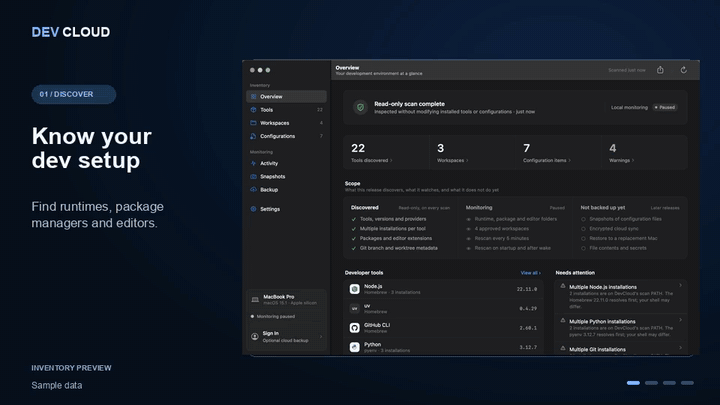
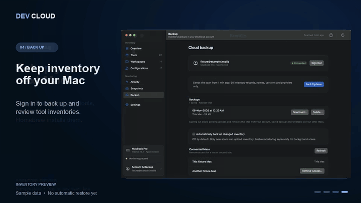

# DevCloud

**Your dev setup, remembered.** DevCloud finds every runtime, package manager, editor and extension on your Mac, tracks what changes, and turns it into a setup file for your next Mac.

<p align="center">
  
</p>

<p align="center">
  <a href="https://github.com/SaadNiaziDev/dev-cloud/releases"><b>Download for macOS</b></a> ·
  <a href="assets/media/devcloud-preview.mp4">Watch the 26-second video</a> ·
  <a href="#move-to-a-new-mac">Move to a new Mac</a> ·
  <a href="CLOUD_BACKUP.md">Cloud backup</a>
</p>

Free · macOS 14 or later · Apple silicon and Intel · the demo uses sample data.

## Why

A new Mac takes a day of remembering: which Node versions, which Python, that one CLI you installed in March, forty editor extensions. DevCloud keeps that list for you, without running your tools or reading your code.

## What it does

| | |
|---|---|
| **Discover** | Homebrew formulae and apps, Node, Python, Rust, Go, Java, Xcode tools, VS Code and Cursor with their extensions, and version managers like nvm and pyenv. |
| **Understand** | See versions, where each tool came from, and when two installations fight over your `PATH`. |
| **Track** | Opt in to monitoring from the menu bar. DevCloud records every install, upgrade and removal, and lets you save and compare snapshots. |
| **Back up** | Sign in with GitHub to keep an off-device copy of your tool list, so it survives a lost or broken Mac. |
| **Set up a new Mac** | Save a Brewfile of your tools, apps and VS Code extensions, and let Homebrew install them. |

## Move to a new Mac

<p align="center">
  
</p>

**On your old Mac**, open DevCloud and either:

- **Snapshots → Save Setup File…** to save a `Brewfile` right away (no account needed), or
- **Backup → Back Up Now** to keep the list in your account.

**On your new Mac:**

1. Install [Homebrew](https://brew.sh) and Apple's Command Line Tools (`xcode-select --install`).
2. Install DevCloud (below), sign in, open **Backup**, choose **Review** on your backup, then **Save Setup File…**. Or copy over the `Brewfile` you saved.
3. Read the file, delete anything you don't want, then run:

   ```sh
   brew bundle --file ~/Downloads/Brewfile
   ```

4. Run the commented steps at the end yourself, such as `nvm install 22.11.0` or `cursor --install-extension …`.

DevCloud never runs the file. Homebrew installs its current versions, not necessarily the ones you had. Formulae from third-party taps need `brew tap` first. Configuration files, dotfiles and secrets are not included.

## Install

Download `DevCloud.dmg` from the [latest release](https://github.com/SaadNiaziDev/dev-cloud/releases) and drag DevCloud to Applications.

The preview is not notarized yet, so macOS blocks the first launch. Open it once with **right-click → Open**, or go to **System Settings → Privacy & Security → Open Anyway**. Check the download against the SHA-256 checksum in the release notes.

## Privacy

- Discovery reads file and folder metadata. It never runs your tools or reads source code, `.env` files or keys.
- Monitoring, workspace folders and cloud backup are all off until you turn them on.
- Cloud backup sends only tool names, versions and sources, plus your Mac's OS version and chip. Paths, workspaces and configuration stay on your Mac. Delete backups or your whole account from the app at any time. Details: [Cloud backup](CLOUD_BACKUP.md).

## Not ready yet

DevCloud does not back up configuration files, dotfiles or secrets, and it does not install anything by itself. Cloud backups are not end-to-end encrypted. Keep your own backups too.

## Build from source

```sh
cargo test --locked
./scripts/package-macos.sh   # dist/DevCloud.app and DevCloud.dmg (universal)
```

Needs Rust 1.95+ with the `aarch64-apple-darwin` and `x86_64-apple-darwin` targets, and Xcode Command Line Tools.
