# Continuity

A native macOS app that keeps an inventory of your development setup — runtimes, package managers, editors, packages, workspaces — and tells you what changed. It reads metadata only, never runs what it finds, and nothing leaves your Mac.

<picture>
  <source media="(prefers-color-scheme: light)" srcset="assets/readme/overview-light.png">
  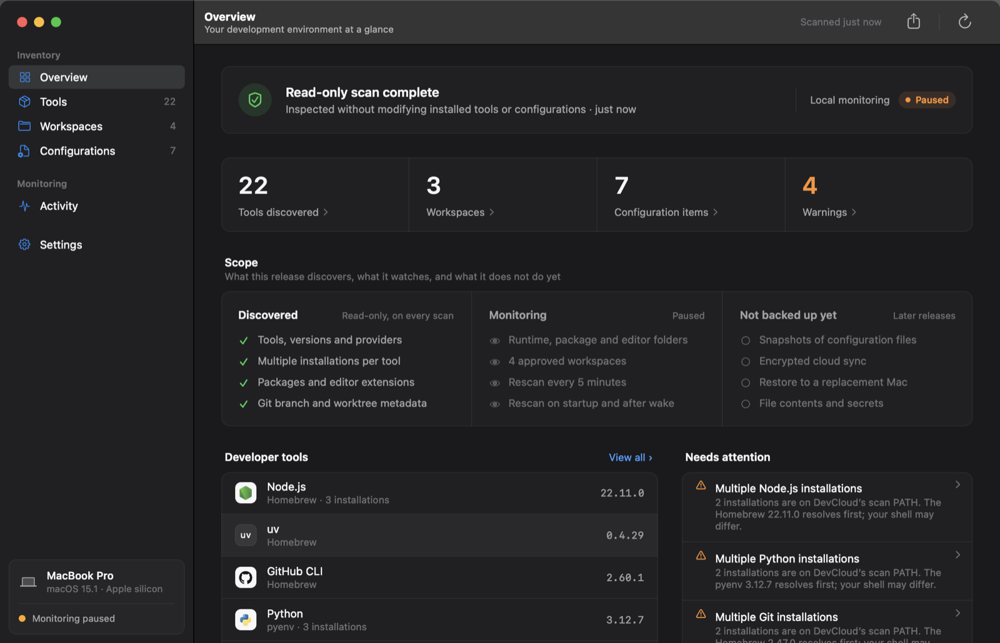
</picture>

<p align="center">
  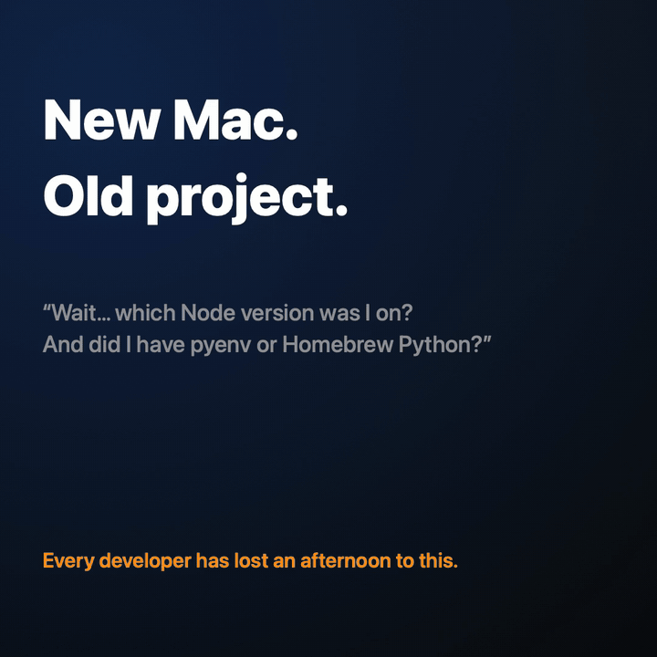
  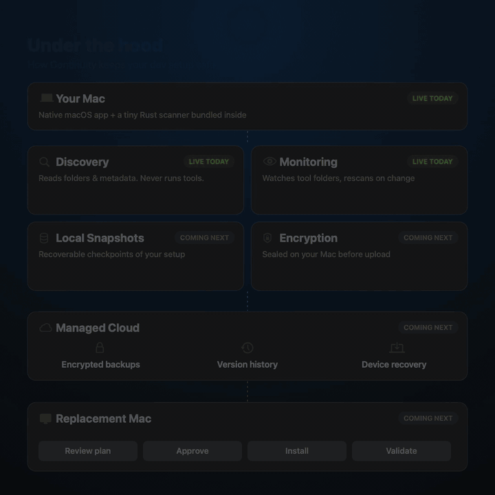
  <br>
  <!-- <sub>Full quality: <a href="assets/media/tour.mp4">tour.mp4</a> · <a href="assets/media/under-the-hood.mp4">under-the-hood.mp4</a></sub> -->
</p>

## How it works

Discover and Monitor ship today. Snapshots, encryption, cloud backup and restore to a replacement Mac are the next phases, shown in the right-hand animation above.

Two processes. The app never touches your tools; a sealed helper reads the filesystem and returns JSON.

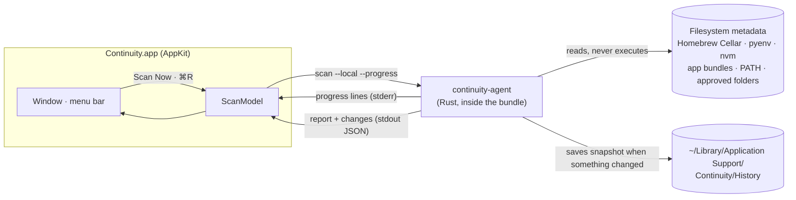

1. **Discover.** The helper walks known install locations (Homebrew, version managers, `/Applications`, editor extension folders, `PATH`). Versions come from folder layout and plists, not from running `--version`.
2. **Compare.** Each scan is diffed against the last one. A snapshot is kept only when something was added, removed, or updated (up to 50 change points).
3. **Show.** The app groups installations per tool, marks the one first on `PATH`, flags conflicts, and rebuilds the Activity timeline from saved snapshots.

### Background monitoring

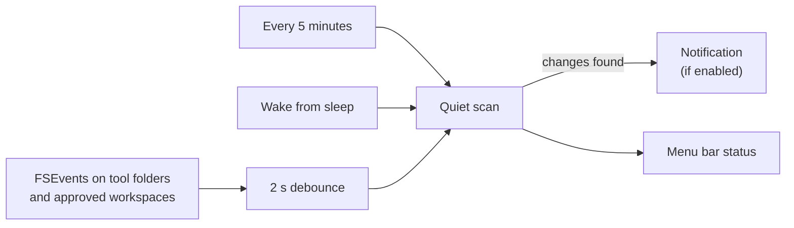

Closing the window keeps monitoring in the menu bar. Quitting stops it — Continuity asks first.

## Tour

### Overview
Scan status, counts that link to each page, what this release does and doesn't cover, tools that changed most recently, and anything that needs attention.

### Tools
Every tool with all its installations. The inspector shows which one resolves first on `PATH`, where each came from, how directly its version was read, and the evidence.

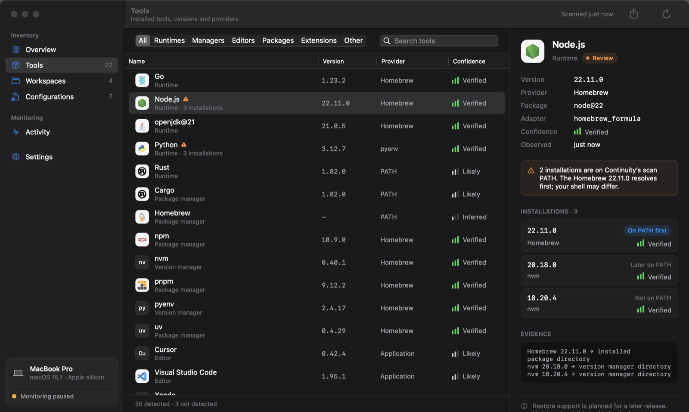

| Confidence | Meaning |
| --- | --- |
| ▮▮▮ Verified | Version and installer both read from metadata |
| ▮▮▯ Likely | Version read; installer unknown |
| ▮▯▯ Inferred | Found, but no version recorded |

Common tools that weren't found are listed under **Not detected**, so absence is explicit.

### Workspaces
Folders you approve (⇧⌘O). For Git repositories: current branch and linked worktree count. Nothing else.

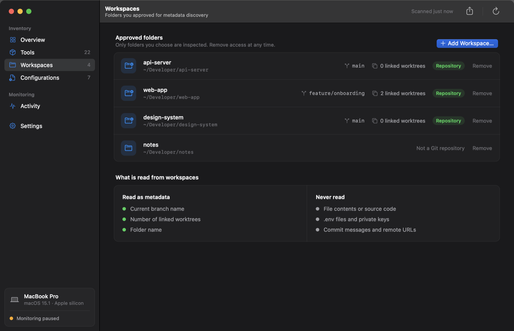

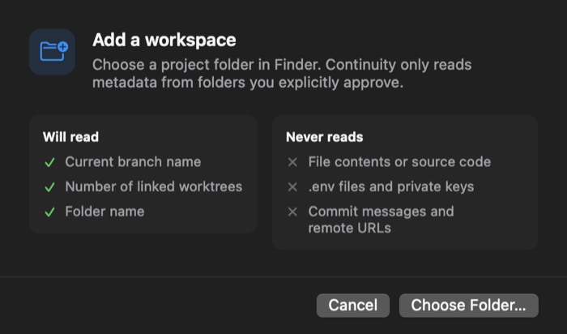

### Configurations
Opt-in sources, each off by default: MCP servers (Claude Desktop, Cursor), an allowlist of VS Code/Cursor settings, unrecognised `PATH` executables, and installation paths.

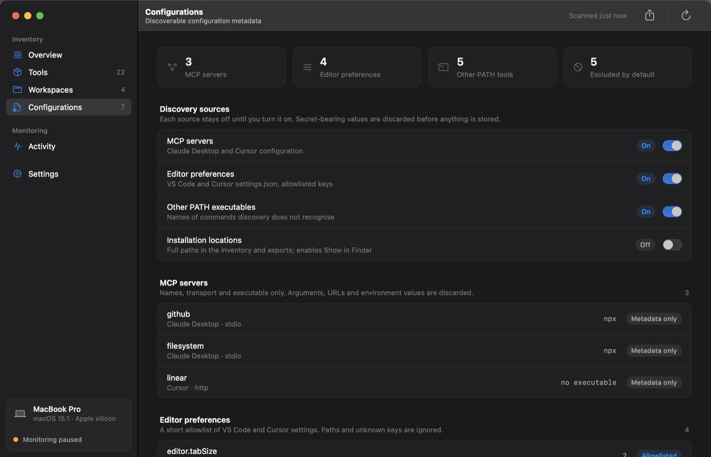

### Activity
A timeline rebuilt from saved snapshots: scans, and every tool added, updated, or removed between them.

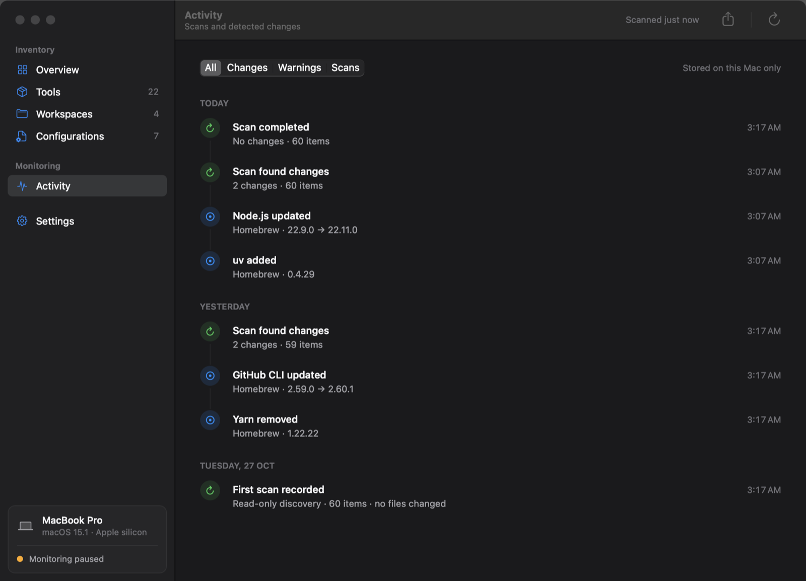

### Settings
Launch at login, background monitoring, change notifications, installation paths, and JSON export.

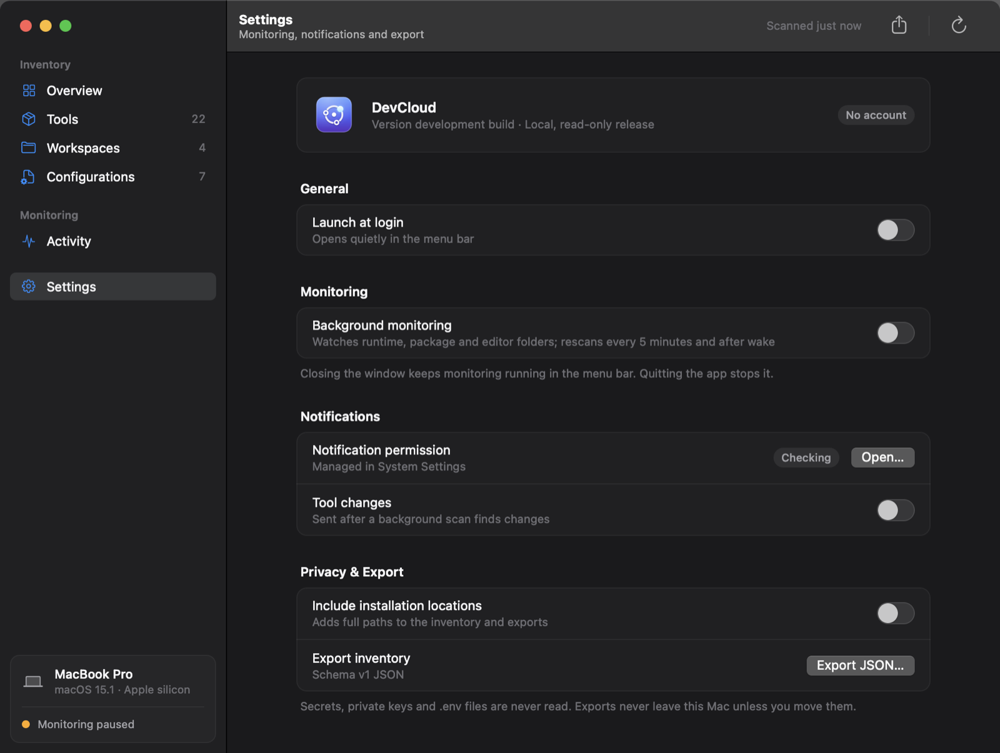

### Menu bar
Monitoring switch, last scan, top warnings, and commands. An amber dot on the icon means something needs attention.

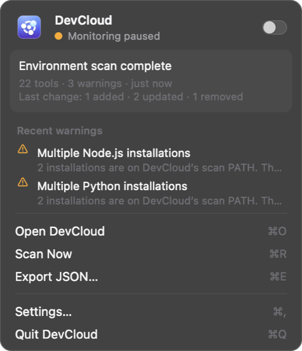

### Export
Saves the latest report as JSON (schema v1), optionally with workspace and configuration metadata.

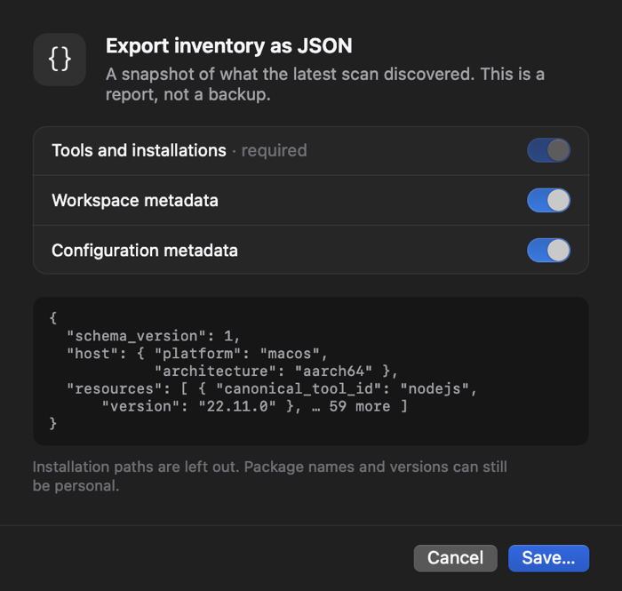

## Privacy

| Read | Never read |
| --- | --- |
| Folder names and layout of install locations | File contents or source code |
| Version strings from plists and package metadata | `.env` files, SSH keys, cloud credentials, keychains |
| Branch and worktree count in approved folders | Commit messages, remote URLs, shell history |
| Opt-in: MCP server names, allowlisted editor keys | MCP arguments, URLs, environment values |

History is stored with owner-only permissions. `PATH` results reflect the app's environment and can differ from your terminal. Review exports before sharing — package names can be personal.

## Keyboard

| Shortcut | Action |
| --- | --- |
| ⌘R | Scan now |
| ⌘E | Export JSON |
| ⇧⌘O | Add workspace |
| ⌘F | Find tools |
| ⌘1 – ⌘6 | Overview, Tools, Workspaces, Configurations, Activity, Settings |
| ⌘, | Settings |

## Build

macOS 14+, Apple silicon and Intel. Needs Rust 1.95+ and the Command Line Tools.

```sh
rustup target add aarch64-apple-darwin x86_64-apple-darwin
./scripts/package-macos.sh          # dist/Continuity.app + dist/Continuity.dmg
```

The scanner works on its own:

```sh
cargo run -- scan                   # table
cargo run -- scan --format json     # schema/resource-schema-v1.json
cargo test --locked
```

UI checks render every page, sheet, and the menu bar in light and dark mode at two window sizes, and fail on layout or accessibility problems:

```sh
./scripts/test-ui.sh --screenshots assets/readme-new
```

## Releases

Pushing a tag matching the package version (e.g. `v0.1.0`) builds a universal, ad-hoc signed DMG and creates a **draft prerelease** with a SHA-256 checksum. For a signed, notarized build:

```sh
CONTINUITY_SIGN_IDENTITY="Developer ID Application: Your Name (TEAMID)" \
CONTINUITY_NOTARY_PROFILE="your-notary-profile" \
./scripts/package-macos.sh
```

Tool icons are from [Devicon](https://github.com/devicons/devicon); license and notice ship with the icons.
